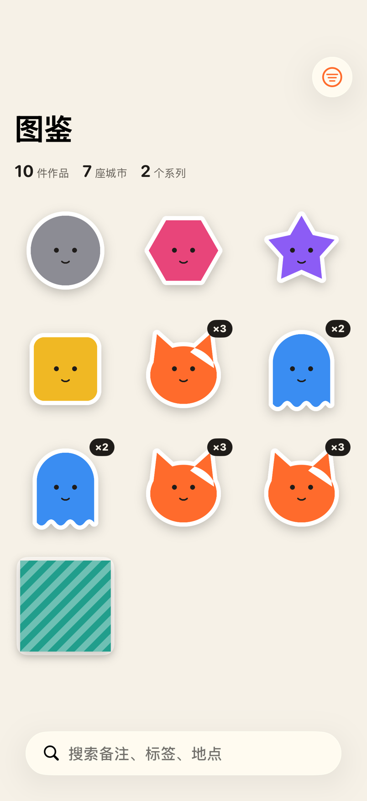

# UI 图库与屏幕清单

**[打开 UI 图库 →](https://passerbo.github.io/GeoGhost/ui/)** · [English](https://passerbo.github.io/GeoGhost/ui/en.html) · [日本語](https://passerbo.github.io/GeoGhost/ui/ja.html)

图库列出 GeoGhost 的每个屏幕、弹层和关键组件，以及它们各种状态当前的样子。图片由测试自动渲染，合并到 main 后自动更新，不需要打开 Xcode。

## 它由什么组成

| 文件 | 内容 |
|---|---|
| [ui/screen.yaml](https://github.com/PasserBo/GeoGhost/blob/main/ui/screen.yaml) | 屏幕清单：每个屏幕有哪些状态，用哪份固定数据渲染 |
| [ui/event.yaml](https://github.com/PasserBo/GeoGhost/blob/main/ui/event.yaml) | 事件清单：值得统计的用户行为（目前只是定义，尚未上报） |
| [ui/snapshots/](https://github.com/PasserBo/GeoGhost/tree/main/ui/snapshots) | 基准图：每个状态渲染出来的图片 |
| [ui/translations.yaml](https://github.com/PasserBo/GeoGhost/blob/main/ui/translations.yaml) | 图库说明文字的英语和日语翻译 |
| [ui/README.md](https://github.com/PasserBo/GeoGhost/blob/main/ui/README.md) | 怎么比对、重录基准图，怎么加一个屏幕或状态 |

## 怎么用

- **想看某个屏幕现在长什么样**：打开图库，按屏幕名找。浅色、深色和三种语言并排显示。图库页面本身有简体中文、英语、日语三个版本，右上角切换；截图是同一套。
- **想看某次改动改了哪些界面**：在 GitHub 的 pull request 里打开 Files changed，基准图的前后对比可以并排、滑动或叠加查看。
- **想提设计意见**：在图库的图片上标注后发给开发者即可。

图里的贴纸是程序画的占位图案，不是真实的街头作品。还没有图的状态（相机取景等）在图库里会写明原因。

行为规格在 [Spec](spec/BOARD.md)；这里只管界面。
